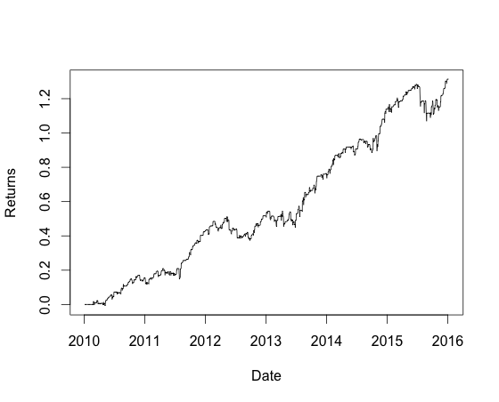
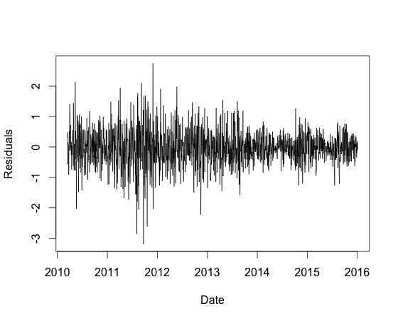

# trading-backtest

> **Fork note:** this is my fork of [lukstei/trading-backtest](https://github.com/lukstei/trading-backtest) by Lukas Steinbrecher, released under the MIT license in 2016. The backtesting engine, the Kalman filter and the cointegration strategy are his work. My changes are listed in [What I changed](#what-i-changed). The original README starts at [What?](#what) and is updated only where it no longer matched the code.

## What I changed

The 2016 code no longer ran as it was: it needed Gradle 2.5, and `BacktestMain` exited unless you had an Alpha Vantage API key (the Yahoo API from the original README is gone). I got it building and running again, then read through the engine to understand how the numbers in the report are calculated. Along the way I found and fixed some bugs.

### 1. Max drawdown bug

I found this one while reading `Statistics.java` to see how the risk numbers were worked out. `drawdown()` started its running peak at `Double.MIN_VALUE`. In Java that is the smallest *positive* double (about 4.9e-324), not the most negative number. The result was also never capped at 0. So for an account that only went up, the "worst drop" came out as a gain: 100 -> 110 -> 120 reported a max drawdown of **+10 (+9.09%)** instead of **0**. A single value returned `(x, Double.MAX_VALUE)`. The answer was right whenever the series had a real dip, which is why the bug was easy to miss.

Before:

```java
double max = Double.MIN_VALUE;
double ddPct = Double.MAX_VALUE;
double dd = Double.MAX_VALUE;

for (double x : series) {
    dd = Math.min(x - max, dd);
    ddPct = Math.min(x / max - 1, ddPct);
    max = Math.max(max, x);
}
```

After:

```java
double dd = 0;
double ddPct = 0;
if (series.length <= 1) {
    return new double[]{dd, ddPct};
}

// peak so far
double max = series[0];
for (int i = 1; i < series.length; i++) {
    double x = series[i];
    dd = Math.min(x - max, dd);
    // pct only with a positive peak
    if (max > 0) {
        ddPct = Math.min(x / max - 1, ddPct);
    }
    max = Math.max(max, x);
}
```

Now the peak starts at the first value, and the drawdown starts at 0 and can only go down. Empty or single-value input returns 0. Max drawdown was also calculated but never printed, so `BacktestMain` now prints it.

### 2. Commissions in P/L and final value

`Backtest.finish()` built the P/L and final value from the gross closed P/L, which leaves out commissions. Meanwhile the account value history, which Sharpe and drawdown are calculated from, did subtract commissions. Now P/L, final value and return are net of all commissions, the same as the rest of the report. On the bundled data the old calculation would have printed P/L 9,653.29 and Result 64.36%. The fixed code prints 4,932.33 and 32.88%, because 4,720.96 went to commissions. `finish()` also replaces the last point of the account value history with the equity after the final liquidation, so the final value and the history behind Sharpe and drawdown end on the same number.

Annualized return now comes from one place, `Result.getAnnualizedReturn()`, which is return * 250 / days (simple, not compounded). Before, `BacktestMain` worked it out a second time using 251 days.

### 3. New stats in the report

- **Max drawdown**: amount and percent.
- **Calmar ratio**: annualized return / |max drawdown %|. It shows `n/a` when there is no drawdown.
- **`TradeStats`** (new class): counts trades as round trips. A pairs trade opens and closes both legs (GLD and GDX) on the same days, so consecutive closed orders with the same open and close dates count as one trade. From those trades it works out the win rate, the **profit factor** (gross profit / |gross loss|), the average win and the average loss. These use P/L before commissions, and the report says so.

### 4. CSV price loader and bundled data

The new `CsvHistoricalPriceService` reads `data/<SYMBOL>.csv`. It accepts files in Stooq, Yahoo (it uses `Adj Close` when present), Nasdaq (`Close/Last`, `$` prices, `MM/dd/yyyy`, newest first) and Alpha Vantage formats. It skips blank lines and rows without a valid price, and sorts by date. `BacktestMain` now uses `data/` by default. It only uses Alpha Vantage if you pass a key.

The repo includes `data/GLD.csv` and `data/GDX.csv`: daily closing prices from Nasdaq.com's historical data, 2016-11-09 to 2026-11-06, 2,512 trading days each, with columns `date,close`. These are closing prices, not dividend-adjusted. GLD pays no dividends; GDX pays a small yearly dividend.

### 5. Build

- Gradle wrapper 2.5 -> 9.1.0.
- `build.gradle` uses a `plugins {}` block and `implementation` / `testImplementation`.
- Dependency versions are pinned instead of `+` ranges.
- It compiles for Java 17 (`options.release = 17`), so you need JDK 17 or newer.
- I removed `rxjava-async-util`, which nothing used.

### 6. Tests

The original project had no tests. There are now 34 JUnit 4 tests:

| Test class | Tests | What it checks |
|---|---|---|
| `StatisticsTest` | 7 | drawdown on rising (including 100/110/120), falling, recovering, empty and single-value series |
| `TradeStatsTest` | 7 | two legs grouped into one trade, mixed wins and losses, flat trades, all wins, all losses, no trades |
| `BacktestTest` | 5 | `BuyAndHold` on small made-up price series: commissions in P/L and final value, drawdown never positive, Calmar |
| `CsvHistoricalPriceServiceTest` | 15 | each file format, bad rows, missing file, header and date edge cases |

## Quick start

You need JDK 17 or newer. The first run of the wrapper downloads Gradle 9.1.0 and the dependencies.

```
./gradlew test    # run the tests
./gradlew run     # backtest GLD vs GDX on the bundled data
```

On Windows use `gradlew.bat` instead of `./gradlew`.

**Other price files.** Put one `<SYMBOL>.csv` per instrument in `data/`, then change `x` and `y` at the top of `BacktestMain.main`. Each file needs:

- a header row,
- a date column named `date` or `timestamp`, in `yyyy-MM-dd` or `MM/dd/yyyy` format,
- a price column. The loader takes the first one it finds from `Adj Close`, `adj_close`, `adjclose`, `Close`, `Close/Last`.

Only dates that appear in both files are used. The path `data/` is relative to the working directory, so run from the project root (`./gradlew run` already does).

**Alpha Vantage.** The original Alpha Vantage loader is still there, unchanged. To use it instead of the CSV files:

```
./gradlew run -Dalphavantantage.apikey=YOUR_KEY
```

The property name keeps the original spelling. `build.gradle` passes it through to the app. You can also set `alphaVantantageApiKey` in `BacktestMain`. Note that the loader asks for `outputsize=full`, and Alpha Vantage's documentation now lists the full history as premium-only, so a free key may not work.

## Example run

`./gradlew run` on the bundled data (most of the 978 order lines left out):

```
Using price files from data/
14:59:27.418 [main] DEBUG org.lst.trading.main.strategy.kalman.CointegrationTradingStrategy - Kalman filter statistics: /tmp/out-14530079080786175415.csv
id,amount,side,instrument,from,to,open,close,pl
1,763,Sell,GDX,2016-12-27T00:00:00Z,2016-12-30T00:00:00Z,19.870000,20.920000,-801.150000
2,136,Buy,GLD,2016-12-27T00:00:00Z,2016-12-30T00:00:00Z,108.560000,109.610000,142.800000
...
977,181,Sell,GDX,2026-11-04T00:00:00Z,2026-11-06T00:00:00Z,84.590000,87.600000,-544.810000
978,39,Buy,GLD,2026-11-04T00:00:00Z,2026-11-06T00:00:00Z,372.490000,372.520000,1.170000

Backtest result of class org.lst.trading.main.strategy.kalman.CointegrationTradingStrategy: CointegrationStrategy{mY='GDX', mX='GLD'}
Prices: MultipleDoubleSeries{mNames={GLD, GDX, from=2016-11-09T00:00:00Z, to=2026-11-06T00:00:00Z, size=2512}
Simulated 2512 days, Initial deposit 15000, Leverage 4.000000
Commissions = 4720.96
P/L = 4932.33, Final value = 19932.33, Result = 32.88%, Annualized = 3.27%, Sharpe (rf=0%) = 0.24
Max drawdown = -5995.14 (-39.97%), Calmar = 0.08
Trades = 489 round trips (978 orders), Win rate = 67.3%, Profit factor = 1.20
Avg win = 174.25, Avg loss = -297.96 (before commissions)
Orders: /tmp/out-260723472649513956.csv
Statistics: /tmp/out-17598248908400904818.csv
```

How to read it:

- The strategy won 67.3% of its 489 round trips. The average loss (-297.96) is bigger than the average win (174.25), though, so the profit factor is only 1.20.
- Before commissions the trades made 9,653.29. Commissions took 4,720.96 of that, leaving 4,932.33.
- Over ten years that is a 32.88% return (3.27% a year, simple), with a Sharpe ratio of 0.24 and a max drawdown of -39.97% at 4x leverage.

This is much weaker than the original README's 150.97% for 2010-2016. Part of the gap is that the 2016 version did not subtract its 2,938.19 of commissions from P/L; with them it is about 131%. The rest is the market. Pairs trading only works while the two prices stay cointegrated, and with the same settings the strategy earned far less on gold vs gold miners in 2016-2026.

The order list, the P/L history and the Kalman filter values are written to temp CSV files (the paths above) so you can load them into R, Excel or Python.

---

*The sections below are Lukas Steinbrecher's original README, updated where the code changed.*

## What?

This is a general purpose lightweight backtesting engine for stocks, written in Java.

Some advantages compared to other backtesting implementations are:

* It uses a callback model and since it is implemented in java it should be pretty performant when running many backtests
* Easily extensible
* Strategies are easily debuggable using a Java IDE
* Lightweight and therefore the backtesting engine is easily verifiable
* Backtesting results are further analyzable in R or Excel since it uses a CSV output format


### Cointegration/Pairs trading

I've written this library primarily to try out this particular strategy.

The cointegration strategy, or also known as pairs trading strategy, tries to take two stocks and create a linear model to find a
optimal hedge ratio between them in order create a stationary process.

Assume stocks A and B with prices `Pa` and `Pb` respectively, we set `Pa = alpha + beta*Pb` and try to find optimal `alpha` and `beta`.
One method to find `alpha` and `beta` is using a so called Kalman Filter which is a dynamic bayesian model and we use it as an online linear regression model to get our values.

After we've found the values we look at the residuals given by `residuals = Pa - alpha - beta*Pb`,
and if the last residual is greater than some threshold value you go short `n` A stocks and long `n*beta` B stocks, for some fixed `n`.

For further explanation and a formal definition of cointegration and the strategy you may want to look at:

* https://www.quantopian.com/posts/how-to-build-a-pairs-trading-strategy-on-quantopian (Quantopian has since shut down, so this link no longer works) or
* Ernie Chan's book Algorithmic Trading: Winning Strategies and Their Rationale

A good introduction video series to the Kalman filter can be found at Udacity (https://www.udacity.com/wiki/cs373/unit-2).

## How?

### Running a backtest

Run a backtest skeleton:

```java
void doBacktest() {
        String x = "GLD";
        String y = "GDX";

        // initialize the trading strategy
        TradingStrategy strategy = new CointegrationTradingStrategy(x, y);

        // load historical prices from data/GLD.csv and data/GDX.csv
        HistoricalPriceService finance = new CsvHistoricalPriceService("data");
        MultipleDoubleSeries priceSeries = new MultipleDoubleSeries(finance.getHistoricalAdjustedPrices(x).toBlocking().first(), finance.getHistoricalAdjustedPrices(y).toBlocking().first());

        // initialize the backtesting engine
        int deposit = 15000;
        Backtest backtest = new Backtest(deposit, priceSeries);
        backtest.setLeverage(4);

        // run the backtest
        Backtest.Result result = backtest.run(strategy);

        // show results
        System.out.println(format(Locale.US, "P/L = %.2f, Final value = %.2f, Result = %.2f%%, Annualized = %.2f%%, Sharpe (rf=0%%) = %.2f", result.getPl(), result.getFinalValue(), result.getReturn() * 100, result.getAnnualizedReturn() * 100, result.getSharpe()));
        System.out.println(format(Locale.US, "Max drawdown = %.2f%%, Calmar = %.2f", result.getMaxDrawdownPercent() * 100, result.getCalmar()));
}
```

`BacktestMain` does the same and also prints the trade stats from `result.getTradeStats()`.

### Creating a new strategy

Just create a class which implements `org.lst.trading.lib.model.TradingStrategy`, for example a simple buy and hold strategy might look like this:

```java
public class BuyAndHold implements TradingStrategy {
    Map<String, Order> mOrders;
    TradingContext mContext;

    @Override public void onStart(TradingContext context) {
        mContext = context;
    }

    @Override public void onTick() {
        if (mOrders == null) {
            mOrders = new HashMap<>();
            mContext.getInstruments().stream().forEach(instrument -> mOrders.put(instrument, mContext.order(instrument, true, 1)));
        }
    }
}
```

The `onTick()` method is called for every price change, all relevant information (like historical prices, etc..) is available through
`TradingContext` and also orders can be submitted through it.


## Interesting classes to look at

* [Backtest](src/main/java/org/lst/trading/lib/backtest/Backtest.java): The core class which runs the backtest
* package `org.lst.trading.lib.series`:
  * [TimeSeries](src/main/java/org/lst/trading/lib/series/TimeSeries.java): A general purpose generic time series data structure implementation and which handles stuff like mapping, merging and filtering.
  * [DoubleSeries](src/main/java/org/lst/trading/lib/series/DoubleSeries.java): A time series class which has doubles as values. (corresponds to a pandas.Series (python))
  * [MultipleDoubleSeries](src/main/java/org/lst/trading/lib/series/MultipleDoubleSeries.java): A time series class which has multiple doubles as values. (corresponds to a pandas.DataFrame or a R Dataframe)
* [KalmanFilter](src/main/java/org/lst/trading/main/strategy/kalman/KalmanFilter.java):  A general purpose and fast Kalman filter implementation.
* [Cointegration](src/main/java/org/lst/trading/main/strategy/kalman/Cointegration.java):  A cointegration model using a Kalman filter.
* [CointegrationTradingStrategy](src/main/java/org/lst/trading/main/strategy/kalman/CointegrationTradingStrategy.java):  The cointegration strategy implementation.

Added or changed in this fork:

* [Statistics](src/main/java/org/lst/trading/lib/util/Statistics.java): Sharpe ratio, returns and the fixed max drawdown.
* [TradeStats](src/main/java/org/lst/trading/lib/backtest/TradeStats.java): Round trip trade stats (win rate, profit factor, average win and loss).
* [CsvHistoricalPriceService](src/main/java/org/lst/trading/lib/util/CsvHistoricalPriceService.java): Loads daily prices from local CSV files.


### Example run of the cointegration strategy

To run a backtest, edit and then run the main class `org.lst.trading.main.BacktestMain`.
By default the cointegration strategy is executed with the `GLD` vs. `GDX` ETF's. See [Example run](#example-run) above for the output on the bundled 2016-2026 data.

Below is the original author's run from early 2016, kept for reference. It downloaded 2010-2016 prices from Yahoo's old `ichart` API, which no longer exists. That version also did not subtract commissions from P/L, so the 150.97% would be about 131% after the 2,938.19 in commissions.

```
19:35:28.327 [RxCachedThreadScheduler-1] DEBUG org.lst.trading.lib.util.Http - GET http://ichart.yahoo.com/table.csv?s=GLD&a=0&b=1&c=2010&d=0&e=6&f=2016&g=d&ignore=.csv
19:35:29.655 [RxCachedThreadScheduler-1] DEBUG org.lst.trading.lib.util.Http - GET http://ichart.yahoo.com/table.csv?s=GDX&a=0&b=1&c=2010&d=0&e=6&f=2016&g=d&ignore=.csv

1,364,Buy,GDX,2010-02-23T00:00:00Z,2010-02-25T00:00:00Z,40.658018,41.566845,330.813028
...
577,1081,Sell,GDX,2015-12-23T00:00:00Z,2015-12-28T00:00:00Z,13.970000,13.790000,194.580000
578,145,Buy,GLD,2015-12-23T00:00:00Z,2015-12-28T00:00:00Z,102.309998,102.269997,-5.800145

Backtest result of class org.lst.trading.main.strategy.kalman.CointegrationTradingStrategy: CointegrationStrategy{mY='GDX', mX='GLD'}
Prices: MultipleDoubleSeries{mNames={GLD, GDX, from=2010-01-04T00:00:00Z, to=2016-01-05T00:00:00Z, size=1512}
Simulated 1512 days, Initial deposit 15000, Leverage 4.000000
Commissions = 2938.190000
P/L = 22644.75, Final value = 37644.75, Result = 150.97%, Annualized = 25.06%, Sharpe (rf=0%) = 1.37

Orders: /var/folders/_5/jv4ptlps2ydb4_ptyj_l2y100000gn/T/out-7373128809679149089.csv
Statistics: /var/folders/_5/jv4ptlps2ydb4_ptyj_l2y100000gn/T/out-1984107031930922019.csv
```

To further investigate the results you can import the CSV files into some data analysis tool like R or Excel.

I've created a R script which does some rudimentary analysis (in `src/main/r/report.r`). Edit the CSV paths at the top of the script to point at your own output files.

The return curve of the above strategy (the 2016 run) plotted using R:



This is a plot of the implied residuals:



The cointegration can be quite profitable however the difficulty is to find some good cointegrated pairs.

You might want to try for example Coca-Cola (KO) and Pepsi (PEP), gold (GLD) and gold miners (GDX) or Austrialia stock index (EWA) and Canada stock index (EWC) (both Canada and Australia are commodity based economies).


## Why?

I'm generally interested in algorithmic trading and I read about the cointegration trading strategy in Ernest Chans Book and wanted to try it out.
I know many people prefer using tools like Matlab and R to try out their strategies, and I also agree with them you can't get
a prototype running faster using these technologies, however after the prototyping phase I prefer to implement my strategies
in a "full blown" programming language where I have a mature IDE, good debugging tools and less 'magic' where I know exactly what is going on under the hood.

This is a side project and I'm not planning to extend this further.

It is thought as a educational project, if you want to do something similar, this may be a good starting point or if you just want to try out different strategies.
I thought it might be useful for someone so I decided to make this open source.
Feel free to do anything what you want with the code.

## Who?

My name is Lukas Steinbrecher, I'm interested in financial markets, (algorithmic) trading, computer science and also bayesian statistics (especially MCMC methods).

If you have any questions or comments feel free to contact me via lukas@lukstei.com or on [lukstei.com](https://lukstei.com).

## License

MIT - see [LICENSE](LICENSE). Original work copyright (c) 2016 lukstei. The changes in this fork are under the same license.
